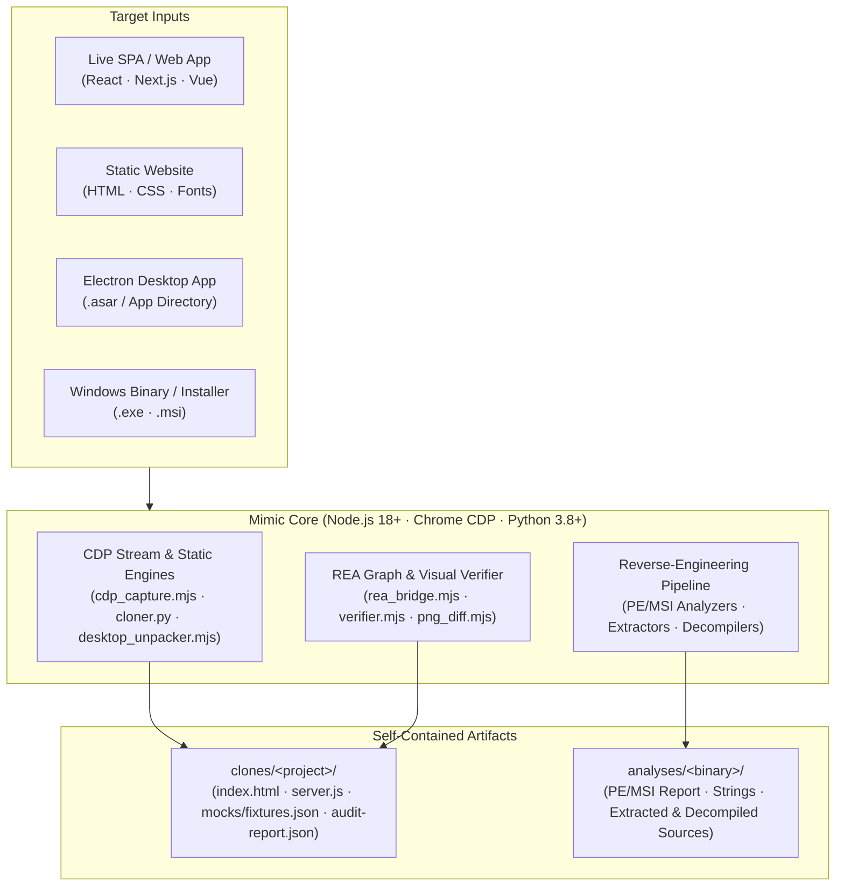

<div align="center">

<h1>Mimic</h1>

<p>
  <strong>High-fidelity web capture, deterministic offline replay, and software reverse-engineering suite.</strong>
</p>

[](https://github.com/LukaG712/Mimic/actions/workflows/ci.yml)


[](package.json)

<p>
  Mimic unifies <strong>in-flight Chrome DevTools Protocol (CDP) capture</strong>, <strong>parallel static crawling</strong>, and <strong>Windows/Electron reverse engineering</strong> in a single CLI and local web workbench — emitting self-contained, zero-dependency clones ready for offline replay, visual auditing, or containerized export.
</p>

<p>
  <a href="#quick-start"><strong>Quick Start</strong></a> &nbsp;·&nbsp;
  <a href="#platform-pillars"><strong>Features</strong></a> &nbsp;·&nbsp;
  <a href="#architecture"><strong>Architecture</strong></a> &nbsp;·&nbsp;
  <a href="#engine-matrix"><strong>Engines</strong></a> &nbsp;·&nbsp;
  <a href="#security--isolation"><strong>Security</strong></a> &nbsp;·&nbsp;
  <a href="#reference--configuration"><strong>Reference</strong></a>
</p>

</div>

---

> [!TIP]
> **Zero-Dependency Clone Runtime:** Every captured web application ships with a standalone `server.js`, recorded `mocks/fixtures.json` API payloads, and locally mirrored CDN assets. Run any clone 100% offline with `--offline`—no external cloud or database required.

---

## Platform Pillars

<table>
  <tr>
    <td width="50%" valign="top">
      <h3>🌐 In-Flight CDP &amp; Static Ingestion</h3>
      <ul>
        <li><strong>Stream Interception:</strong> Captures Chrome network responses in flight before eviction or SPA mutation, stripping analytics and telemetry hosts automatically.</li>
        <li><strong>DOM Hydration:</strong> Scrolls pages to trigger lazy loading, serializes <code>&lt;canvas&gt;</code> elements to inline PNGs, and rewrites external CDNs to <code>/external/&lt;host&gt;/</code>.</li>
        <li><strong>12-Worker Crawler:</strong> Parallel Python engine (<code>cloner.py</code>) ingests static HTML, scripts, stylesheets, <code>@font-face</code>, and CSS <code>url(...)</code> assets.</li>
      </ul>
    </td>
    <td width="50%" valign="top">
      <h3>🔁 Zero-Dependency Local Proxy</h3>
      <ul>
        <li><strong>Query-Hash Matching:</strong> Resolves URL query strings against MD5 query-hash suffixes (<code>_&lt;hash&gt;</code>) generated during capture.</li>
        <li><strong>Magic-Byte Sniffing:</strong> Inspects buffer headers on extensionless or <code>.bin</code> payloads to serve exact <code>Content-Type</code> headers (PNG, WebP, AVIF, WOFF2, SVG, JSON).</li>
        <li><strong>Deterministic Replay:</strong> Matches <code>/api/*</code>, GraphQL, and <code>/_next/data/*</code> requests against <code>mocks/fixtures.json</code> by method, path, query, and body hash.</li>
      </ul>
    </td>
  </tr>
  <tr>
    <td width="50%" valign="top">
      <h3>🎯 Visual Audit &amp; REA Graph</h3>
      <ul>
        <li><strong>Multi-Viewport Audit:</strong> Boots clones on an ephemeral port in headless Chrome at Desktop (<code>1440×900</code>) and Mobile (<code>390×844</code>).</li>
        <li><strong>Pixel-Diff &amp; DOM Checks:</strong> Audits broken images, failed fonts, video errors, missing <code>&lt;svg&gt;&lt;use&gt;</code> symbols, overflow, and generates <code>diff-desktop.png</code>.</li>
        <li><strong>REA JS Analysis:</strong> Optional <code>rea-agents</code> integration extracts routes, API endpoints, chunk graphs, and framework inferences into <code>clone-manifest.json</code>.</li>
      </ul>
    </td>
    <td width="50%" valign="top">
      <h3>🔬 Binary &amp; Desktop Reverse Engineering</h3>
      <ul>
        <li><strong>Electron <code>.asar</code> Unpacker:</strong> Extracts desktop Electron apps and app directories into inspectable, runnable web clones.</li>
        <li><strong>PE / MSI Inspection:</strong> Identifies PE32/PE32+, .NET, PyInstaller, Nuitka, AutoIt, UPX/VMProtect packers, and MSI OLE2 databases without executing binaries.</li>
        <li><strong>Decompilation &amp; Export:</strong> Integrates <code>ilspycmd</code>, Ghidra, <code>objdump</code>, and <code>7z</code>; exports web clones to <code>.zip</code>, <code>Dockerfile</code>, or Windows Electron wrappers.</li>
      </ul>
    </td>
  </tr>
</table>

---

## Architecture



---

## Engine Matrix

Choose the ingestion engine that matches your target—or launch **Mimic Studio** (`npm start`) to orchestrate all of them from a single web UI:

| Command | Engine | Requirements | Output |
| :--- | :--- | :--- | :--- |
| **`capture`** *(SPAs)* | Headless Chrome CDP | Node 18+ & Chrome/Chromium | `clones/<name>/` + `mocks/fixtures.json` |
| **`clone`** *(Static)* | 12-worker Python crawler | Node 18+ & Python 3.8+ | `clones/<name>/` + `server.js` |
| **`unpack`** *(Desktop)* | Electron `.asar` unpacker | Node 18+ | `clones/<name>/` + `server.js` |
| **`inspect-bin`** *(PE/MSI)* | Built-in PE/MSI/PyInstaller parser | **None** *(optional: `7z`, `ilspycmd`, Ghidra, `objdump`)* | `analyses/<name>/` |
| **`analyze`** *(JS Graph)* | REA static analyzer | Optional `rea-agents` (`rea` on `PATH`) | `rea-analysis.json` |
| **`verify`** *(QA Audit)* | Headless Chrome + PNG diff | Node 18+ & Chrome/Chromium | `audit-report.json` + `diff-desktop.png` |

---

## Security & Isolation

> [!IMPORTANT]
> Mimic is engineered with strict non-execution guarantees for inspecting untrusted web bundles, desktop archives, and Windows installers.

- **Zero Binary Execution:** Uploaded `.exe` binaries, extracted scripts, and MSI `CustomAction` entries are never automatically executed.
- **Path-Traversal Enforcement:** Both the generated `server.js` proxy and `src/reverse/` extractors validate every resolved path against the workspace root (`isSafeSubpath`), blocking `/../` and `%2e%2e` escapes.
- **Process Timeout Boundaries:** External reverse-engineering tools run via timeout-bounded child processes (`runToolSafe`); they are **not** OS-level sandboxes—always use a dedicated VM or container when inspecting untrusted malware.
- **Honest Outcome Reporting:** Binary analysis reports explicitly distinguish `decompiled`, `extracted`, `partial`, `unsupported`, and `failed` states.

---

## Quick Start

### Option 1 — Mimic Studio (Web Workbench)

Launch the built-in local dashboard with live Server-Sent Events (SSE) logs, a **Clone Inspector**, and a **Software Analysis** workbench:

```bash
git clone https://github.com/LukaG712/Mimic.git
cd Mimic
npm start
```

Open **`http://localhost:4000`** in your browser. Override the port with `DASHBOARD_PORT` or scan an external clones directory with `MIMIC_EXTRA_CLONES_DIR`.

---

### Option 2 — CLI Web Capture, Verify & Serve

```bash
# 1. Capture a rendered SPA with live network stream + API fixture recording
node src/cli.js capture https://example.com example-app

# 2. Run headless Desktop (1440x900) + Mobile (390x844) audit & pixel diff
node src/cli.js verify example-app

# 3. Serve locally in strict offline mode (no upstream requests)
node src/cli.js serve example-app --port 3000 --offline
```

---

### Option 3 — Binary Reverse Engineering & Desktop Unpacking

```bash
# Inspect, unpack, and decompile Windows .exe and .msi packages
node src/cli.js inspect-bin /path/to/app.exe
node src/cli.js inspect-bin /path/to/installer.msi --json

# Unpack an Electron .asar archive or app directory into a runnable clone
node src/cli.js unpack /path/to/app.asar electron-clone

# Check which optional reverse-engineering tools are available on this machine
node src/cli.js tools
```

<details>
<summary><strong>Additional CLI Workflows &amp; Test Suite</strong></summary>

```bash
# Capture with REA live bundle analysis + multi-route internal crawling
node src/cli.js capture https://example.com example-app --rea --crawl --max-routes 10

# Capture authenticated apps via cookies, headers, or interactive headed login
node src/cli.js capture https://app.example.com app-clone --cookies cookies.json --header "Authorization: Bearer token"
node src/cli.js capture https://app.example.com app-clone --interactive-login

# Parallel static HTML/CSS/font crawl via Python
node src/cli.js clone https://example.com example-static --port 3001

# Run offline REA JavaScript application graph analysis
node src/cli.js analyze example-app

# Export a clone as a .zip archive, Dockerfile, or Windows Electron wrapper
node src/cli.js export example-app --format zip
node src/cli.js export example-app --format docker
node src/cli.js export example-app --format electron

# Workspace management & test suite
node src/cli.js list
node src/cli.js remove example-app
npm test
```

</details>

---

## Reference & Configuration

<details>
<summary><strong>CLI Flags &amp; Options Matrix</strong></summary>

| Flag | Applies To | Description |
| :--- | :--- | :--- |
| `--port <number>` | `clone`, `capture`, `serve`, `verify` | Port written into `server.js` or bound when serving (default `3000`). |
| `--offline` | `serve` | Disable upstream fallback and return `404` on uncaptured assets (`MIMIC_OFFLINE=1`). |
| `--crawl` | `capture` | Crawl internal same-origin `<a>` and REA-discovered routes in the same CDP session. |
| `--max-routes <num>` | `capture` | Maximum internal routes to crawl when `--crawl` is set (default `10`). |
| `--cookies <file\|str>` | `capture` | Path to a cookies JSON file or `k=v; ...` cookie string to inject before navigation. |
| `--header <k:v>` | `capture` | Custom HTTP request header to inject during capture. |
| `--interactive-login` | `capture` | Launch a headed Chrome window and wait for `[Enter]` before capturing. |
| `--rea` | `capture` | Run `rea analyze-web-bundle` against the live page and save `rea-bundle.json`. |
| `--fetch-source-maps` | `capture` | Fetch script source maps when running `capture --rea`. |
| `--full-evidence` | `analyze` | Save the complete REA Evidence record to `rea-evidence.json` alongside `rea-analysis.json`. |
| `--source-path <paths>` | `analyze` | Comma-separated relative JS paths to restrict static analysis scope. |
| `--no-scroll` | `capture` | Skip the full-page scroll pass before extracting the DOM. |
| `--timeout <ms>` | `capture`, `verify` | Maximum run time in ms before aborting (`60000` for `capture`, `45000` for `verify`). |
| `--format <zip\|docker\|electron>` | `export` | Package format for `export` (default `zip`). |
| `--out <path>` | `export` | Output `.zip` file path. |
| `--quiet`, `-q` | `capture`, `clone`, `verify`, `analyze`, `export`, `remove` | Suppress progress logs. |
| `--json` | `capture`, `clone`, `verify`, `analyze`, `export`, `remove`, `list`, `inspect-bin`, `tools` | Print a single compact JSON summary line to stdout. |

</details>

<details>
<summary><strong>Optional Reverse-Engineering Toolchain (Linux &amp; Windows 11)</strong></summary>

Mimic performs PE, MSI, and PyInstaller static inspection with **zero** optional tools installed. Installing optional tools unlocks deeper extraction and source recovery:

| Tool | Purpose | Linux (Debian / Ubuntu) | Windows 11 |
| :--- | :--- | :--- | :--- |
| `7z` / `7za` | Extract NSIS, Burn, CAB, SFX, ZIP | `sudo apt install p7zip-full` | `winget install 7zip.7zip` |
| `ilspycmd` | Decompile `.NET` assemblies to C# | `dotnet tool install -g ilspycmd` | `dotnet tool install -g ilspycmd` |
| `analyzeHeadless` | Ghidra native C pseudocode decompilation | Install Ghidra & set `GHIDRA_HOME` | Install Ghidra & set `GHIDRA_HOME` |
| `objdump` | Intel-syntax native PE disassembly | `sudo apt install binutils` | MSYS2 / MinGW `binutils` |
| `innoextract` | Extract Inno Setup `.exe` installers | `sudo apt install innoextract` | `winget install dsquier.innoextract` |
| `upx` | Unpack UPX-packed executables | `sudo apt install upx-ucl` | `winget install UPX.UPX` |
| `msiinfo` / `msiextract` | Inspect & extract `.msi` databases | `sudo apt install msitools` | Built-in read-only COM fallback + `lessmsi` |
| `uncompyle6` / `decompyle3` | Decompile `.pyc` bytecode to `.py` | `pip install decompyle3 uncompyle6` | `pip install decompyle3 uncompyle6` *(stdlib `dis` built-in)* |

</details>

<details>
<summary><strong>Environment Variables</strong></summary>

| Variable | Description | Default |
| :--- | :--- | :--- |
| `DASHBOARD_PORT` | Port for Mimic Studio (`npm start`) | `4000` |
| `CHROME_PATH` | Explicit path to Chrome or Chromium binary | Auto-detected |
| `MIMIC_OFFLINE` | Set to `1` to enforce strict offline mode in generated `server.js` | `0` |
| `MIMIC_EXTRA_CLONES_DIR` | Additional workspace directory scanned by Mimic Studio | *(unset)* |
| `GHIDRA_HOME` | Ghidra installation directory for `analyzeHeadless` | *(unset)* |

</details>

---

## Repository Structure

```text
Mimic/
├── .github/workflows/ci.yml           # CI workflow running npm test (Node 22 + stable Chrome)
├── clones/                            # Captured web projects (gitignored except .gitkeep)
├── analyses/                          # Binary/MSI analysis outputs (gitignored)
├── docs/                              # Architecture & implementation plans
├── src/
│   ├── cli.js                         # Master CLI entry point
│   ├── dashboard.js                   # Mimic Studio web UI (port 4000) with SSE logs
│   ├── engine/                        # CDP capture, Python crawler, Chrome finder, PNG diff, REA bridge, ASAR unpacker
│   ├── reverse/                       # Windows PE/MSI detection, extractors, decompilers & pipeline
│   └── server/
│       └── proxy_server.template.js   # Zero-dependency per-clone proxy & fixture replay server
└── test/                              # 8 unit & end-to-end integration test suites
```

## Documentation & Tests

- [In-Flight CDP Stream Harvester Plan](docs/superpowers/plans/2026-11-10-in-flight-cdp-stream-harvester.md)
- [Windows Reverse-Engineering Architecture Plan](docs/superpowers/plans/2026-11-15-windows-reverse-engineering.md)
- Run the full suite locally with `npm test` (verified on every push via [GitHub Actions](.github/workflows/ci.yml)).

---

<div align="center">
  <sub>Built for high-fidelity web archival and static software inspection. MIT License.</sub>
</div>
