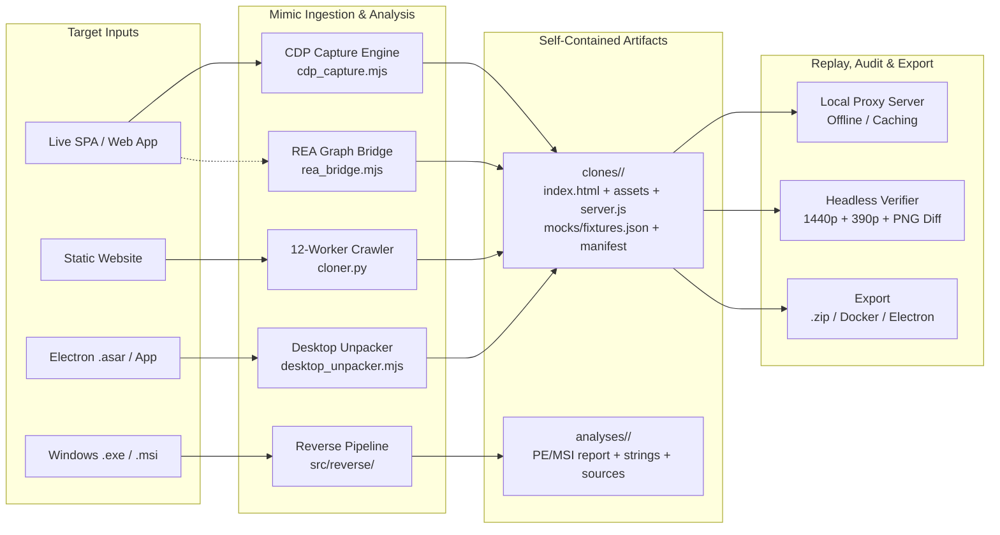

# Mimic

**High-fidelity web capture, deterministic offline replay, and binary reverse-engineering suite.**

[](https://github.com/LukaG712/Mimic/actions/workflows/ci.yml)
[](https://nodejs.org/)
[](https://www.python.org/)
[](package.json)

Mimic captures live client-rendered web applications in flight via the Chrome DevTools Protocol (CDP), ingests static sites through a parallel Python crawler, unpacks Electron `.asar` desktop bundles, and performs static inspection and safe decompilation on Windows `.exe` and `.msi` packages. Every captured web project is emitted as a self-contained, zero-dependency local bundle with recorded API fixtures, visual pixel-diff verification, and Docker/Electron export.

[Quick Start](#quick-start) · [Architecture](#architecture) · [CLI Reference](#cli-reference) · [Engine Internals](#engine-internals) · [Reverse Engineering](#windows--desktop-reverse-engineering) · [Security Model](#security-model)

---

## Why Mimic

Traditional website downloaders fail on modern SPAs, lazy-loaded media, `<canvas>` rendering, authenticated routes, and dynamic API calls. Mimic solves the full lifecycle from ingestion to verified offline execution:

| Capability | Description |
| :--- | :--- |
| **In-Flight CDP Capture** | Intercepts Chrome network responses before eviction or mutation, hydrates lazy assets, serializes `<canvas>` to PNG, strips telemetry hosts, and rewrites CDN URLs locally. |
| **Parallel Static Crawler** | 12-worker Python engine (`cloner.py`) that ingests HTML, scripts, stylesheets, and recursively resolves `@font-face` and CSS `url(...)` assets. |
| **Zero-Dependency Local Proxy** | Every clone ships with a standalone `server.js` featuring MD5 query-hash resolution, magic-byte MIME sniffing, API fixture replay, and strict path-traversal guards. |
| **Automated Visual & DOM Audit** | Boots each clone in headless Chrome at Desktop (`1440x900`) and Mobile (`390x844`), checks fonts/images/video/SVG symbols, and generates a pixel-level `diff-desktop.png`. |
| **Electron & Export Pipeline** | Unpacks Electron `.asar` applications into inspectable web clones and exports any project as a `.zip` archive, `Dockerfile`, or Windows Electron wrapper. |
| **PE / MSI Reverse Engineering** | Safely inspects PE32/PE32+, .NET, PyInstaller, Nuitka, AutoIt, UPX/VMProtect, and MSI OLE2 packages without executing untrusted code. |
| **Mimic Studio** | Built-in local web workbench (`http://localhost:4000`) with live Server-Sent Events (SSE) execution logs, Clone Inspector, and Software Analysis views. |

---

## Quick Start

### Prerequisites

- **Node.js 18+** (CLI, CDP capture, Mimic Studio, and per-clone proxy servers)
- **Google Chrome or Chromium** (auto-detected across Linux, macOS, and Windows, or set `CHROME_PATH`)
- **Python 3.8+** (used by `clone` and `export --format zip`)
- **`rea-agents`** *(optional)* — `rea` on `PATH` for live bundle and offline JS graph analysis (`--rea`, `analyze`)

### Launch Mimic Studio

```bash
git clone https://github.com/LukaG712/Mimic.git
cd Mimic
npm start
```

Open `http://localhost:4000` in your browser. Override the port with `DASHBOARD_PORT` or scan an external workspace with `MIMIC_EXTRA_CLONES_DIR`.

### Capture, Verify, and Serve via CLI

```bash
# 1. Capture a client-rendered SPA with live network stream + API fixture recording
node src/cli.js capture https://example.com example-app

# 2. Run headless Desktop + Mobile DOM audit and pixel-diff verification
node src/cli.js verify example-app

# 3. Serve locally in strict offline mode (no upstream network requests)
node src/cli.js serve example-app --port 3000 --offline
```

<details>
<summary><strong>Example Output: Emitted Clone Bundle &amp; <code>clone-manifest.json</code></strong></summary>

```text
clones/example-app/
├── index.html               # Hydrated DOM with eager media & rewritten /external/<host>/ paths
├── server.js                # Zero-dependency local proxy & fixture replay server
├── package.json             # Standalone project metadata
├── clone-manifest.json      # Asset counts, byte totals, crawled routes, structural tags
├── baseline-desktop.png     # Reference capture screenshot (1440x900)
├── screenshot.png           # Post-capture verification render
├── diff-desktop.png         # Pixel-level visual diff generated by verify
├── audit-report.json        # Console/network error summary, font/image/overflow checks
├── mocks/
│   └── fixtures.json        # Recorded JSON, GraphQL, and /api/* responses for offline replay
└── external/                # Locally mirrored third-party CDN assets
```

</details>

---

## Architecture



### Engine Selection Guide

| Command | Engine | Best For | Output Target |
| :--- | :--- | :--- | :--- |
| `capture <url>` | Headless Chrome CDP | React, Next.js, Vue, authenticated SPAs, API-driven apps | `clones/<name>/` |
| `clone <url>` | Python ThreadPool (12 workers) | Documentation, marketing pages, static HTML/CSS/font sites | `clones/<name>/` |
| `unpack <asar\|dir>` | ASAR Unpacker | Electron desktop applications | `clones/<name>/` |
| `inspect-bin <file>` | Static PE / MSI / Decompiler | Windows `.exe` binaries, `.NET`, PyInstaller, `.msi` installers | `analyses/<name>/` |

---

## CLI Reference

Invoke commands via `node src/cli.js <command>` (or `npx mimic <command>` when linked).

### Web Capture & Static Analysis

```bash
# Capture a rendered SPA and its network stream via headless Chrome
node src/cli.js capture https://example.com example-app

# Capture with REA live bundle analysis + multi-route internal crawling
node src/cli.js capture https://example.com example-app --rea --crawl --max-routes 10

# Capture an authenticated app with cookies, custom headers, or interactive headed login
node src/cli.js capture https://app.example.com app-clone --cookies cookies.json --header "Authorization: Bearer token"
node src/cli.js capture https://app.example.com app-clone --interactive-login

# Crawl static HTML, stylesheets, fonts, and scripts via Python
node src/cli.js clone https://example.com example-static --port 3001

# Run offline REA JavaScript application graph analysis against a captured clone
node src/cli.js analyze example-app
```

### Serving, Verification & Export

```bash
# Serve a captured site locally (use --offline to block all upstream fallback)
node src/cli.js serve example-app --port 3000
node src/cli.js serve example-app --port 3000 --offline

# Run headless audit at 1440x900 and 390x844 + pixel diff against baseline
node src/cli.js verify example-app

# Export a clone as a .zip archive, Dockerfile, or Windows Electron wrapper
node src/cli.js export example-app --format zip
node src/cli.js export example-app --format docker
node src/cli.js export example-app --format electron

# List or remove captured projects
node src/cli.js list
node src/cli.js remove example-app
```

### Desktop & Binary Reverse Engineering

```bash
# Unpack an Electron .asar archive or unpacked app directory into a clone
node src/cli.js unpack /path/to/app.asar electron-clone

# Inspect, extract, and decompile Windows .exe and .msi packages
node src/cli.js inspect-bin /path/to/app.exe
node src/cli.js inspect-bin /path/to/installer.msi --json

# Discover installed external reverse-engineering tools
node src/cli.js tools
```

<details>
<summary><strong>Complete CLI Flags &amp; Environment Variables</strong></summary>

#### CLI Flags

| Flag | Applies To | Description |
| :--- | :--- | :--- |
| `--port <number>` | `clone`, `capture`, `serve`, `verify` | Port written into `server.js` or bound when serving (default `3000`). |
| `--offline` | `serve` | Disable upstream fallback and return `404` on uncaptured assets (`MIMIC_OFFLINE=1`). |
| `--crawl` | `capture` | Crawl internal same-origin `<a>` and REA-discovered routes in the same CDP session. |
| `--max-routes <num>` | `capture` | Maximum internal routes to crawl when `--crawl` is set (default `10`). |
| `--cookies <file\|str>` | `capture` | Path to a cookies JSON file or `k=v; ...` cookie string to inject before navigation. |
| `--header <k:v>` | `capture` | Custom HTTP request header to inject during capture. |
| `--interactive-login` | `capture` | Launch a headed Chrome window and wait for `[Enter]` before capturing. |
| `--rea` | `capture` | Run `rea analyze-web-bundle` against the live page and save `rea-bundle.json`. |
| `--fetch-source-maps` | `capture` | Fetch script source maps when running `capture --rea`. |
| `--full-evidence` | `analyze` | Save the complete REA Evidence record to `rea-evidence.json` alongside `rea-analysis.json`. |
| `--source-path <paths>` | `analyze` | Comma-separated relative JS paths to restrict static analysis scope. |
| `--no-scroll` | `capture` | Skip the full-page scroll pass before extracting the DOM. |
| `--timeout <ms>` | `capture`, `verify` | Maximum run time in milliseconds before aborting (`60000` for `capture`, `45000` for `verify`). |
| `--format <zip\|docker\|electron>` | `export` | Output package format for `export` (default `zip`). |
| `--out <path>` | `export` | Output `.zip` file path. |
| `--quiet`, `-q` | `capture`, `clone`, `verify`, `analyze`, `export`, `remove` | Suppress progress logs. |
| `--json` | `capture`, `clone`, `verify`, `analyze`, `export`, `remove`, `list`, `inspect-bin`, `tools` | Emit a single compact JSON summary line to stdout. |

#### Environment Variables

| Variable | Default | Description |
| :--- | :--- | :--- |
| `DASHBOARD_PORT` | `4000` | Port for the Mimic Studio web server (`npm start`). |
| `CHROME_PATH` | Auto-detected | Explicit path to Google Chrome or Chromium executable. |
| `MIMIC_OFFLINE` | `0` | Set to `1` to enforce strict offline mode in generated `server.js` instances. |
| `MIMIC_EXTRA_CLONES_DIR` | Unset | Additional directory scanned by Mimic Studio for clone projects. |
| `GHIDRA_HOME` | Unset | Path to Ghidra installation for headless native PE decompilation (`analyzeHeadless`). |

</details>

---

## Engine Internals

### CDP Stream Harvester (`src/engine/cdp_capture.mjs`)

`capture` launches Chrome with the `Network` domain enabled and intercepts responses in flight before the browser discards or mutates them. Common analytics and telemetry hosts (`google-analytics.com`, `segment.io`, `sentry.io`, `intercom.io`, and similar) are dropped during capture to keep bundles clean.

Once network activity settles, Mimic scrolls the page to trigger intersection observers, converts lazy images (`loading="lazy"`, `data-src`, `data-srcset`) to eager attributes, serializes `<canvas>` elements to inline PNG data URLs, and writes the hydrated DOM to `index.html`. External CDN URLs referenced in HTML and CSS are rewritten to `/external/<host>/...` so the local server resolves them without CORS errors.

### REA Integration (`src/engine/rea_bridge.mjs`)

`capture --rea` invokes `rea analyze-web-bundle` against the live Chrome target before crawling or closing the browser. It saves `rea-bundle.json` and merges detected routes, API endpoints, chunks, and framework inferences into `clone-manifest.json`. `analyze <name>` runs `rea analyze-javascript-application` offline against captured scripts and writes a compact graph summary to `rea-analysis.json`.

### Local Proxy & Fixture Replay (`src/server/proxy_server.template.js`)

Every captured project receives a zero-dependency `server.js`:

1. **Query-Hash Resolution:** Checks the local clone directory first, matching URL query strings against MD5 query-hash suffixes (`_<hash>`) generated by `url_mapper.mjs`.
2. **Magic-Byte MIME Sniffing:** For extensionless or `.bin` assets, inspects buffer headers to detect PNG, JPEG, GIF, WebP, AVIF, WOFF/WOFF2, SVG, HTML, or JSON payloads and sets `Content-Type` accurately.
3. **Deterministic Fixture Replay:** For `/api/*`, `/_next/data/*`, `POST`/`PUT`/`DELETE` requests, or discovered endpoints, checks `mocks/fixtures.json` (matching method, path, query, and request body hash) and replays the recorded payload; otherwise returns `200 OK` with `{"ok":true,"status":"success","mocked":true}`.
4. **Hybrid Caching:** If a static file is missing locally and `--offline` / `MIMIC_OFFLINE=1` is not set, fetches it from origin (or target CDN for `/external/<host>/...`), streams it to the browser, and caches it on disk.

All resolved paths are validated against the clone root directory to block path traversal (`/../` or URL-encoded `%2e%2e`).

### Verification & Pixel Diffing (`src/engine/verifier.mjs`, `src/engine/png_diff.mjs`)

`verify` boots the clone's `server.js` on an ephemeral port, loads it in headless Chrome at `1440x900` and `390x844`, audits broken `` elements, failed `document.fonts`, `<video>` errors, missing `<svg><use>` targets, and horizontal overflow, deduplicates console/network errors, compares `screenshot.png` against `baseline-desktop.png` (writing `diff-desktop.png`), and outputs `audit-report.json`.

---

## Windows & Desktop Reverse Engineering

Mimic includes a modular static analysis, safe extraction, and decompilation subsystem (`src/reverse/`) integrated into both the CLI (`inspect-bin`, `tools`) and the **Software Analysis** section of Mimic Studio.

- **Format & Runtime Identification (`src/reverse/detection/file_identifier.mjs`):** Detects PE32/PE32+, .NET Framework, Modern / Single-File .NET, Electron, PyInstaller, Nuitka, AutoIt, UPX/ASPack/Themida/VMProtect packers, MSI OLE2 packages, and installers (Inno Setup, NSIS, WiX Burn, InstallShield, Advanced Installer, Squirrel, 7-Zip SFX, WinRAR SFX).
- **Static PE & Strings Analysis (`pe_analyzer.mjs`, `strings_analyzer.mjs`):** Extracts sections with Shannon entropy, DLL imports/exports, CodeView PDB paths, CLR `.NET` headers, Authenticode presence, embedded XML manifests, URLs, IPv4 addresses, Windows paths, and registry keys.
- **MSI Database & Extraction (`msi_analyzer.mjs`, `msi_extractor.mjs`):** Parses OLE2 Compound File containers, decodes 6-bit MSI table names, detects embedded `MSCF` CABs and external `.cab` references, and uses `msiinfo`/`msiextract`/`lessmsi`/`7z` (when installed) to inspect MSI tables and extract payloads without executing custom actions.
- **Decompilation Adapters:**
  - **.NET (`dotnet_decompiler.mjs`):** `ilspycmd` for C# source recovery.
  - **Native PE (`native_decompiler.mjs`):** Ghidra Headless (`analyzeHeadless`) for C pseudocode or GNU `objdump` for Intel disassembly.
  - **PyInstaller (`python_decompiler.mjs`):** Built-in CArchive extractor + `uncompyle6`/`decompyle3` or Python stdlib `marshal`/`dis` disassembly.

### Optional External Toolchain

Mimic performs PE, MSI, and PyInstaller static inspection out of the box with **zero** optional tools installed. Installing optional tools unlocks deeper extraction and decompilation:

| Tool | Purpose | Linux (Debian / Ubuntu) | Windows 11 |
| :--- | :--- | :--- | :--- |
| `7z` / `7za` | Extract NSIS, Burn, CAB, SFX, ZIP | `sudo apt install p7zip-full` | `winget install 7zip.7zip` |
| `ilspycmd` | Decompile `.NET` assemblies to C# | `dotnet tool install -g ilspycmd` | `dotnet tool install -g ilspycmd` |
| `analyzeHeadless` | Ghidra native C pseudocode decompilation | Install Ghidra & set `GHIDRA_HOME` | Install Ghidra & set `GHIDRA_HOME` |
| `objdump` | Intel-syntax native PE disassembly | `sudo apt install binutils` | MSYS2 / MinGW `binutils` |
| `innoextract` | Extract Inno Setup `.exe` installers | `sudo apt install innoextract` | `winget install dsquier.innoextract` |
| `upx` | Unpack UPX-packed executables | `sudo apt install upx-ucl` | `winget install UPX.UPX` |
| `msiinfo` / `msiextract` | Inspect & extract `.msi` databases | `sudo apt install msitools` | Built-in read-only COM fallback + `lessmsi` |
| `uncompyle6` / `decompyle3` | Decompile `.pyc` bytecode to `.py` | `pip install decompyle3 uncompyle6` | `pip install decompyle3 uncompyle6` *(stdlib `dis` built-in)* |

---

## Security Model

- **No Automatic Execution:** Target binaries, extracted scripts, and MSI `CustomAction` entries are never automatically executed.
- **Path-Traversal Enforcement:** Both the local proxy server and binary/archive extractors validate all resolved paths against their workspace root (`isSafeSubpath`).
- **Process Isolation Boundary:** Static analysis and archive extraction run in-process or via timeout-bounded child processes (`runToolSafe`); they are **not** OS-level sandboxes. Always run Mimic inside a dedicated VM or container when analyzing untrusted malware.
- **Honest Reporting:** Binary analysis reports explicitly distinguish `decompiled`, `extracted`, `partial`, `unsupported`, and `failed` outcomes.

---

## Project Structure

```text
├── .github/workflows/ci.yml         # CI workflow running npm test (Node 22 + stable Chrome)
├── clones/                          # Captured sites (gitignored except .gitkeep)
├── analyses/                        # Binary/MSI analysis outputs (gitignored)
├── src/
│   ├── cli.js                       # CLI entry point
│   ├── dashboard.js                 # Mimic Studio web UI (port 4000) with SSE logs
│   ├── engine/                      # Web capture, Chrome finder, PNG diff, REA bridge, desktop unpacker
│   ├── reverse/                     # Windows PE/MSI detection, extraction, decompilation & pipeline
│   └── server/
│       └── proxy_server.template.js # Per-clone local server, fixture replay & upstream cache
└── test/
    ├── cdp_stream.test.mjs          # End-to-end CDP capture, crawl, fixture & timeout test
    ├── dashboard.test.mjs           # Studio API & client script compilation test
    ├── desktop_unpacker.test.mjs    # Electron .asar unpacker tests
    ├── new_features.test.mjs        # Chrome finder, PNG diff, fixture replay & offline mode tests
    ├── rea_bridge.test.mjs          # REA output parser & JS application analysis test
    ├── reverse_engineering.test.mjs # PE, .NET, PyInstaller, MSI & path-traversal safety tests
    ├── turnkey_scaffold.test.mjs    # Scaffold, MIME sniffing & path-traversal test
    └── url_mapper.test.mjs          # URL mapping, tracker filter & CDN rewrite unit tests
```

---

## Testing

Run the full unit and integration test suite:

```bash
npm test
```

All 8 test suites run automatically on every push and pull request via [GitHub Actions](.github/workflows/ci.yml).

---

## License

Released under the [MIT License](package.json).
